<!-- tailor:social-header:start -->
<p align="center">
  <a href="https://linuxmatters.sh/jive/encoder/"><picture><source media="(prefers-color-scheme: dark)" srcset="pages/social/hero-dark.svg"></picture></a>
</p>
<!-- tailor:social-header:end -->

<!-- tailor:social-links:start -->
<p align="center">
  <a href="https://bsky.app/profile/wimpys.world"><picture><source media="(prefers-color-scheme: dark)" srcset="pages/social/link-bluesky-dark.svg"></picture></a>
  <a href="https://wimpysworld.social/@martin"><picture><source media="(prefers-color-scheme: dark)" srcset="pages/social/link-mastodon-dark.svg"></picture></a>
  <a href="https://linkedin.com/in/martinwimpress"><picture><source media="(prefers-color-scheme: dark)" srcset="pages/social/link-linkedin-dark.svg"></picture></a>
</p>
<!-- tailor:social-links:end -->

<!-- tailor:social-community:start -->
<p align="center">
  <a href="https://discord.com/invite/vUsydfP"><picture><source media="(prefers-color-scheme: dark)" srcset="https://raw.githubusercontent.com/linuxmatters/jive-encoder/social-assets/community-dark.svg"></picture></a>
</p>
<!-- tailor:social-community:end -->

Jive Encoder (formerly Jivedrop) takes your mixed podcast audio (WAV or FLAC) and outputs RSS-ready podcast files with optimised encoding, embedded artwork, and complete metadata. Choose MP3 for universal compatibility, AAC for Apple-recommended quality, or Opus for modern Android and web delivery.

## Features

- **Multi-format output** via `--format mp3|aac|opus` (default: `mp3`):
  - **MP3**: CBR 112 kbps mono / 192 kbps stereo, 44.1 kHz, LAME quality 3, 20.5 kHz lowpass
  - **AAC**: CBR 64 kbps mono / 128 kbps stereo, 44.1 kHz, `.m4a` (Apple-recommended)
  - **Opus**: VBR ~32 kbps mono / ~48 kbps stereo, 48 kHz, `.opus` (Android and web)
- **Format-native metadata** with the correct tags for each container:
  - MP3: ID3v2.4 tags with embedded cover art
  - AAC: iTunes MP4 atoms with embedded cover art
  - Opus: Vorbis comments (text tags; no embedded cover)
  - Episode title, number, album, artist, date, comment, and podcast enclosure stats for duration and bytes
- **Dual-mode workflow**:
  - **Hugo mode**: read metadata from episode markdown and update frontmatter values
  - **Standalone mode**: specify metadata via command-line flags
- **Single binary** for Linux (`amd64`, `aarch64`) and macOS (`x86_64`, Apple Silicon)

<!-- tailor:social-stats:start -->
<p align="center">
  <a href="https://github.com/linuxmatters/jive-encoder/pulse"><picture><source media="(prefers-color-scheme: dark)" srcset="https://raw.githubusercontent.com/linuxmatters/jive-encoder/social-assets/stats-dark.svg"></picture></a>
</p>
<!-- tailor:social-stats:end -->

## Install

First-party signed package repositories are published for Linux and macOS through [wimpys.world](https://wimpys.world/). Choose your platform below for setup instructions and automatic updates.

<!-- tailor:social-packages:start -->
<p align="center">
  <a href="https://apt.wimpys.world/#jive-encoder"><picture><source media="(prefers-color-scheme: dark)" srcset="pages/social/pkg-apt-dark.svg"></picture></a>
  <a href="https://rpm.wimpys.world/#jive-encoder"><picture><source media="(prefers-color-scheme: dark)" srcset="pages/social/pkg-rpm-dark.svg"></picture></a>
  <a href="https://pkg.wimpys.world/#jive-encoder"><picture><source media="(prefers-color-scheme: dark)" srcset="pages/social/pkg-pkg-dark.svg"></picture></a>
  <br>
  <a href="https://brew.wimpys.world/#jive-encoder"><picture><source media="(prefers-color-scheme: dark)" srcset="pages/social/pkg-brew-dark.svg"></picture></a>
  <a href="https://nix.wimpys.world/#jive-encoder"><picture><source media="(prefers-color-scheme: dark)" srcset="pages/social/pkg-nix-dark.svg"></picture></a>
</p>
<!-- tailor:social-packages:end -->

The Linux packages and binaries need glibc 2.38 or later, for example Ubuntu 24.04, Debian 13, or Fedora 39.

<details>
<summary><strong>Any platform (<code>bin</code>)</strong> - install and update the release binary directly</summary>

[bin](https://github.com/marcosnils/bin) installs and updates the release binary:

```shell
bin install github.com/linuxmatters/jive-encoder
```

</details>

<!-- tailor:social-sponsors:start -->
<p align="center">
  <a href="https://github.com/sponsors/flexiondotorg"><picture><source media="(prefers-color-scheme: dark)" srcset="pages/social/sponsors-dark.svg"></picture></a>
</p>
<!-- tailor:social-sponsors:end -->

## Quick start

### Hugo Mode (Integrated Workflow)

For podcasts using the Hugo static site generator and a theme like [Castanet](https://github.com/mattstratton/castanet), Jive Encoder reads metadata from episode markdown:

- Reads episode title and number from frontmatter
- Locates cover art from the `episode_image` field
- Applies Linux Matters defaults (artist, album, comment)
- Outputs frontmatter-ready values for `podcast_duration` and `podcast_bytes`
- Prompts to update Hugo frontmatter

```bash
# Basic encoding (MP3 by default)
jive-encoder LMP67.flac episode/67.md

# Encode as AAC for Apple-recommended distribution
jive-encoder LMP67.flac episode/67.md --format aac

# Override Hugo defaults
jive-encoder LMP67.flac episode/67.md --artist "Ubuntu Podcast" --comment "https://ubuntupodcast.org"
```

<!-- tailor:social-demo:start -->
<p align="center">
  <picture><source media="(prefers-color-scheme: dark)" srcset="pages/social/demo-dark.svg"></picture>
</p>
<!-- tailor:social-demo:end -->

### Standalone Mode (Universal Workflow)

For podcasts without Hugo, specify metadata via flags:

- Required flags: `--title`, `--num`, and `--cover`
- Optional metadata: `--artist`, `--album`, `--date`, `--comment`, `--format`
- Smart filename generation: `{artist}-{num}.{ext}` or `episode-{num}.{ext}`
- Album defaults to the artist value if not specified

```bash
# Minimal (title, episode number, and cover art required)
jive-encoder audio.flac \
  --title "Terminal Full of Sparkles" \
  --num 66 \
  --cover artwork.png

# Encode as Opus (note: Opus is not accepted by Apple Podcasts)
jive-encoder audio.flac \
  --title "Terminal Full of Sparkles" \
  --num 66 \
  --cover artwork.png \
  --format opus

# Full metadata
jive-encoder audio.flac \
  --title "Terminal Full of Sparkles" \
  --num 66 \
  --artist "Linux Matters" \
  --album "All Seasons" \
  --date "2025-10" \
  --comment "https://linuxmatters.sh/66" \
  --cover artwork.png \
  --format aac
```

## CLI Reference

```
Usage:
  Hugo mode:
    jive-encoder <audio-file> <episode-md> [flags]
  Standalone mode:
    jive-encoder <audio-file> --title TEXT --num NUMBER --cover PATH [flags]


Arguments:
  [<audio-file>]  Path to audio file (WAV, FLAC)
  [<episode-md>]  Path to episode markdown file (Hugo mode)


Flags:
  -h, --help     Show context-sensitive help.
  --num          Episode number, must be a non-negative integer (required in standalone mode)
  --title        Episode title (required in standalone mode)
  --artist       Artist name (defaults to 'Linux Matters' in Hugo mode)
  --album        Album name (defaults to artist value if omitted)
  --date         Release date (YYYY-MM-DD format)
  --comment      Comment URL (defaults to 'https://linuxmatters.sh' in Hugo mode)
  --cover        Cover art path (required in standalone mode)
  --output-path  Output file or directory path
  --format       Output format: mp3, aac, or opus (default: mp3)
  --stereo       Encode as stereo at 192kbps (default: mono at 112kbps)
  --version      Show version information
```

### Output

- Hugo mode: `LMP{num}.{ext}` (or `{artist}-{num}.{ext}` with `--artist` override)
- Standalone mode: `{artist}-{num}.{ext}` (or `episode-{num}.{ext}` without `--artist`)

Where `{ext}` is `.mp3`, `.m4a`, or `.opus` depending on `--format`.

If `--output-path` names a file, its extension must match `--format`.

### Encoding settings

| Format | Mono | Stereo | Sample rate | Notes |
| --- | --- | --- | --- | --- |
| MP3 (default) | 112 kbps CBR | 192 kbps CBR | 44.1 kHz | LAME quality 3, 20.5 kHz lowpass |
| AAC | 64 kbps CBR | 128 kbps CBR | 44.1 kHz | AAC-LC, `.m4a` (ipod muxer), no lowpass |
| Opus | ~32 kbps VBR | ~48 kbps VBR | 48 kHz | libopus, `.opus`, no lowpass; 48 kHz is Opus's native rate |

### Metadata tags

Tags are written natively by the muxer for each format.

**MP3: ID3v2.4**

- `TIT2`: `{num}: {title}`
- `TALB`: `{album}` (omitted if not provided)
- `TRCK`: `{num}`
- `TPE1`: `{artist}` (omitted if not provided)
- `TDRC`: `{date}` (defaults to current YYYY-MM)
- `COMM`: `{comment}` (omitted if not provided)
- `APIC`: Cover art (PNG, front cover)

**AAC: iTunes MP4 atoms**

Same fields as MP3, written as MP4 atoms. Cover art embedded.

**Opus: Vorbis comments**

Same text fields as MP3. Cover art is not embedded in Opus files.

## Development

Jive Encoder uses [ffmpeg-statigo](https://github.com/linuxmatters/ffmpeg-statigo) for FFmpeg static bindings.

```bash
# Setup or update ffmpeg-statigo submodule and library
just setup

# Build and test
just build        # Build binary
just test         # Run full vet and tests with console coverage
just lint         # Check workflows, Go source, and vulnerabilities
just lint correct # Tidy modules and format source, then check
just test-encoder # Run the explicit audio-format integration check
```

### Tailor integration

Use `just build`, `just test`, and `just lint` for quality checks. `just build` first builds the managed `bin/` output, then runs `just/project/build.sh` for the versioned root `jive-encoder` binary. `just lint` is read-only. Use `just lint correct` explicitly to tidy modules and format source. The project lint script retains `ineffassign`. Full vet runs in `just test`. `just test-encoder` remains an explicit audio-format check and does not run through the managed commands.

The Nix shell imports the managed packages and hooks with the same `pkgs`, with Go pinned to `go_1_26` and `CGO_ENABLED=1`. All existing packages remain. Pages and MCP declarations remain absent. The root release recipe retains unprefixed tags and the existing release workflow. `just setup` uses the equivalent managed consumer setup. Run it only explicitly: it changes Git configuration, submodules, archives, and the index.

Review and add the managed files to Git before using the shell, because Git flakes omit untracked files. The `.envrc` retains manual reload and watches the managed Nix files. Review the environment changes before normal direnv approval and manual reload.

## Why Jive Encoder?

FFmpeg's CLI can encode podcast-ready audio with metadata, but getting the flags right for CBR encoding, mono downmix, format-native tags, embedded artwork, and lowpass filtering requires a long command line. Switch from MP3 to AAC and every option changes. Add Hugo frontmatter parsing on top and you end up maintaining a script.

Jive Encoder wraps those steps into a single binary that speaks Hugo natively. Drop your WAV, point at your episode markdown, pick your format, and get distribution-ready output with duration and byte counts ready to paste back into your frontmatter.

## Support and contributing

Read [Support](SUPPORT.md) for help and [Contributing](CONTRIBUTING.md) before submitting a change.

<!-- tailor:social-stars:start -->
<p align="center">
  <a href="https://github.com/linuxmatters/jive-encoder/stargazers"><picture><source media="(prefers-color-scheme: dark)" srcset="https://raw.githubusercontent.com/linuxmatters/jive-encoder/social-assets/stars-dark.svg"></picture></a>
</p>
<!-- tailor:social-stars:end -->

<!-- tailor:social-contributors:start -->
<p align="center">
  <a href="https://github.com/linuxmatters/jive-encoder/graphs/contributors"><picture><source media="(prefers-color-scheme: dark)" srcset="https://raw.githubusercontent.com/linuxmatters/jive-encoder/social-assets/contributors-dark.svg"></picture></a>
</p>
<!-- tailor:social-contributors:end -->

<!-- tailor:social-footer:start -->
<p align="center">
  <a href="https://tailor.wimpys.world"><picture><source media="(prefers-color-scheme: dark)" srcset="pages/social/footer-dark.svg"></picture></a>
</p>
<!-- tailor:social-footer:end -->
